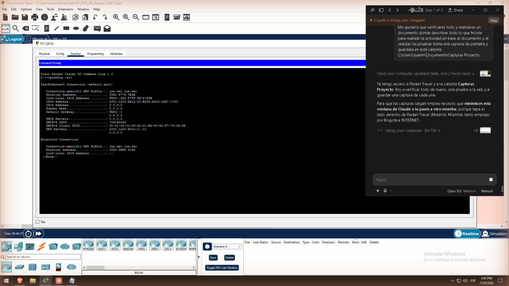

# 2. Esquema de direccionamiento (Tarea 1)

INTERNET usa 7 subredes /30 tomadas de 86.106.78.0/24 (Y = 76 + X = 78). Cada zona IPv6 usa subredes /64 de su /48 [1]. El 4.º hexteto de cada subred LAN es igual al ID de la VLAN (VLAN 30 → `…:30::/64`).

## Espacios asignados (X = 2)

| Bloque | Espacio |
| --- | --- |
| INTERNET (IPv4) | 86.106.78.0/24 |
| Intranet BOG | 2001:1200:EA12::/48 |
| DMZ y túnel | 2001:1200:EC12::/48 |
| Loopbacks | 2001:1200:ED12::/48 |
| Intranet MAD | 2001:1200:EB22::/48 |
| Enlace R2_ESP–MLSW | 2001:1200:ED22::/48 |
| Gestión (IPv4 privada, Tarea 8) | 10.12.30.0/24, 10.12.100.0/24, 10.22.30.0/24, 10.22.255.0/30, 10.255.255.0/30 |

## Guía de diseño estructurado

- **¿Cuántas subredes IPv4?** 7 enlaces punto a punto con 2 hosts cada uno.
- **Máscara mínima:** /30 (2² − 2 = 2 hosts). Se prestan 6 bits: hasta 64 subredes, de las que quedan 57 libres para crecer (86.106.78.28–.255).
- **¿Por qué /64 en IPv6?** Es el tamaño que exigen SLAAC y DHCPv6, porque el identificador de interfaz es de 64 bits [1], [7]. Un /48 da 2¹⁶ = 65 536 subredes /64 por sede.
- **Asignación:** estática para routers, servidores, impresoras, switches y PC7 (destino fijo del Tracker); dinámica por DHCPv6 para los demás PCs.
- **Gateway:** link-local fija `FE80::1` en todas las interfaces de gateway, fácil de reconocer en las capturas.

## Subneteo IPv4 — INTERNET (86.106.78.0/24 → /30)

| # | Enlace | Red | Rango útil | Broadcast | Dominio |
| --- | --- | --- | --- | --- | --- |
| 1 | ISP_BOG – ISP_NET | 86.106.78.0/30 | .1 (ISP_BOG) – .2 (ISP_NET) | .3 | EIGRP |
| 2 | ISP_NET – ISP_ESP | 86.106.78.4/30 | .5 (ISP_NET) – .6 (ISP_ESP) | .7 | EIGRP |
| 3 | ISP_BOG – ISP_FL | 86.106.78.8/30 | .9 (ISP_BOG) – .10 (ISP_FL) | .11 | OSPF |
| 4 | ISP_FL – ISP_ESP | 86.106.78.12/30 | .13 (ISP_FL) – .14 (ISP_ESP) | .15 | OSPF |
| 5 | ISP_NET – ISP_FL | 86.106.78.16/30 | .17 (ISP_NET) – .18 (ISP_FL) | .19 | EIGRP + OSPF |
| 6 | ISP_BOG – R1_BOG | 86.106.78.20/30 | .21 (ISP_BOG) – .22 (R1_BOG) | .23 | Ruta por defecto |
| 7 | ISP_ESP – R2_ESP | 86.106.78.24/30 | .25 (ISP_ESP) – .26 (R2_ESP) | .27 | Ruta por defecto |
| – | Reserva | 86.106.78.28 – .255 | Crecimiento | – | – |

## Subredes IPv6

| Zona | Subred | Uso | Gateway |
| --- | --- | --- | --- |
| BOG VLAN 20 Guest | 2001:1200:EA12:20::/64 | PC1, PC3 | R1_BOG Fa0/0.20 = ::1 |
| BOG VLAN 30 Internal | 2001:1200:EA12:30::/64 | PC2, PC4 | R1_BOG Fa0/0.30 = ::1 |
| BOG VLAN 40 Server/Printer | 2001:1200:EA12:40::/64 | Printer0, Printer1 | R1_BOG Fa0/0.40 = ::1 |
| DMZ | 2001:1200:EC12:1::/64 | Web, DNS, Tracker Server | R1_BOG Fa0/1 = ::1 |
| Túnel BOG–MAD | 2001:1200:EC12:FF::/64 | Tunnel0 | R1 = ::1, R2 = ::2 |
| Loopbacks | 2001:1200:ED12::1/128 y ::2/128 | Lo0 de R1_BOG y R2_ESP | – |
| Enlace R2_ESP–MLSW | 2001:1200:ED22:1::/64 | Puerto ruteado | R2 = ::1, MLSW = ::2 |
| MAD VLAN 20 Guest | 2001:1200:EB22:20::/64 | PC5, PC8 | MLSW Vlan20 = ::1 |
| MAD VLAN 30 Internal | 2001:1200:EB22:30::/64 | PC6, PC7 | MLSW Vlan30 = ::1 |
| MAD VLAN 40 Server/Printer | 2001:1200:EB22:40::/64 | Printer2, Printer3 | MLSW Vlan40 = ::1 |

## Direccionamiento IPv4 de gestión (servicio adicional, Tarea 8)

| Red | Uso |
| --- | --- |
| 10.12.30.0/24 | VLAN 30 Internal BOG: R1_BOG .1, switches BOG, PC2 .10, PC4 .11 |
| 10.12.100.0/24 | DMZ: R1_BOG .1, DNS .11, Tracker Server .12 |
| 10.22.30.0/24 | VLAN 30 Internal MAD: MLSW .1, switches MAD, PC6 .10, PC7 .11 |
| 10.22.255.0/30 | Enlace R2_ESP .1 – MLSW .2 |
| 10.255.255.0/30 | Tunnel1 GRE: R1_BOG .1 – R2_ESP .2 |

Solo existe en la VLAN Internal, la DMZ y los equipos de red. Los invitados no tienen IPv4, así que no pueden alcanzar los agentes SNMP (ver [SNMP](09-SNMP)).

## Tabla de direccionamiento (equipos estáticos)

| Equipo | Interfaz | Dirección | Gateway |
| --- | --- | --- | --- |
| R1_BOG | S0/2/0 | 86.106.78.22/30 | ruta por defecto → 86.106.78.21 |
| R1_BOG | Fa0/0.20 / .30 / .40 | 2001:1200:EA12:20::1 / :30::1 / :40::1 /64 (+ 10.12.30.1/24 en .30) | – |
| R1_BOG | Fa0/1 (DMZ) | 2001:1200:EC12:1::1/64 + 10.12.100.1/24 | – |
| R1_BOG | Tunnel0 · Tunnel1 · Lo0 | EC12:FF::1/64 · 10.255.255.1/30 · ED12::1/128 | – |
| R2_ESP | S0/2/0 | 86.106.78.26/30 | ruta por defecto → 86.106.78.25 |
| R2_ESP | Fa0/0 | 2001:1200:ED22:1::1/64 + 10.22.255.1/30 | – |
| R2_ESP | Tunnel0 · Tunnel1 · Lo0 | EC12:FF::2/64 · 10.255.255.2/30 · ED12::2/128 | – |
| MLSW_MAD | G1/0/1 (ruteado) | 2001:1200:ED22:1::2/64 + 10.22.255.2/30 | ::/0 → ED22:1::1 |
| MLSW_MAD | Vlan20 / 30 / 40 | 2001:1200:EB22:20::1 / :30::1 / :40::1 /64 (+ 10.22.30.1/24 en Vlan30) | – |
| Web_Server | Fa0 | 2001:1200:EC12:1::10/64 | EC12:1::1 |
| DNS Server | Fa0 | 2001:1200:EC12:1::11/64 + 10.12.100.11/24 | EC12:1::1 |
| Tracker Server | Fa0 | 2001:1200:EC12:1::12/64 + 10.12.100.12/24 | EC12:1::1 |
| Printer0 / Printer1 | Fa0 | 2001:1200:EA12:40::20 / ::21 /64 | EA12:40::1 |
| Printer2 / Printer3 | Fa0 | 2001:1200:EB22:40::20 / ::21 /64 | EB22:40::1 |
| PC7 (Dashboard) | Fa0 | 2001:1200:EB22:30::50/64 + 10.22.30.11/24 | EB22:30::1 |

Los PCs dinámicos (PC1–PC6 y PC8) reciben su IPv6 por DHCPv6. La dirección obtenida se ve con `ipconfig /all`:

