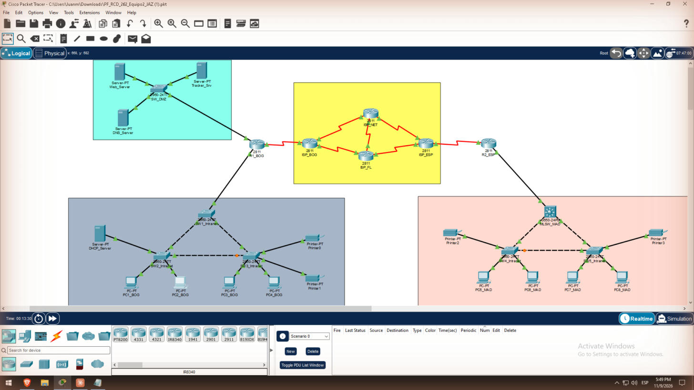

# 3. Montaje y configuración básica (Tarea 2)

Se montaron 6 routers 2811, los switches 2960 de cada sede y de la DMZ, 1 MLSW 3650-24PS, 8 PCs, 4 impresoras y los servidores. Todos llevan los nombres de la Figura 1 (R1_BOG, ISP_NET, SW2, Web_Server…), y todos los enlaces quedaron en verde.



## Montaje

1. **Módulos:** cada 2811 se apagó en la pestaña Physical, se le insertó el WIC-2T y se volvió a encender. Los cuatro ISP llevan dos WIC-2T; R1_BOG y R2_ESP llevan uno. PT rechaza el módulo si el router está encendido.
2. **3650:** se le agregó la fuente AC-POWER-SUPPLY antes de configurarlo.
3. **Cables:**
   - cobre directo entre router y switch, y entre PC y switch;
   - cruzado entre switches;
   - Serial DCE entre routers, empezando por el lado ISP para que el ISP sea el DCE y lleve el `clock rate`.
4. **Beacon:** PT no simula el BLE de forma nativa. Los datos del beacon los genera la Tracker App en PC4 (ver [Employee Tracker](10-Employee-Tracker)).

## Puertos realmente usados

Los WIC-2T quedaron en las ranuras 2 y 3, así que los seriales son S0/2/x y S0/3/x. El mapa se confirmó con `show cdp neighbors`.

| Enlace | Extremo A | Extremo B | Tipo |
| --- | --- | --- | --- |
| ISP_BOG – ISP_NET | ISP_BOG S0/2/0 (DCE) | ISP_NET S0/2/0 | Serial |
| ISP_NET – ISP_ESP | ISP_NET S0/2/1 (DCE) | ISP_ESP S0/2/0 | Serial |
| ISP_BOG – ISP_FL | ISP_BOG S0/3/0 (DCE) | ISP_FL S0/2/0 | Serial |
| ISP_FL – ISP_ESP | ISP_FL S0/2/1 (DCE) | ISP_ESP S0/2/1 | Serial |
| ISP_NET – ISP_FL | ISP_NET S0/3/0 (DCE) | ISP_FL S0/3/0 | Serial |
| ISP_BOG – R1_BOG | ISP_BOG S0/2/1 (DCE) | R1_BOG S0/2/0 | Serial |
| ISP_ESP – R2_ESP | ISP_ESP S0/3/0 (DCE) | R2_ESP S0/2/0 | Serial |
| R1_BOG – Intranet BOG | R1_BOG Fa0/0 | SW1 (trunk) | Directo |
| R1_BOG – DMZ | R1_BOG Fa0/1 | SW_DMZ | Directo |
| R2_ESP – MLSW | R2_ESP Fa0/0 | MLSW G1/0/1 (ruteado) | Directo |

En los 2960, los troncales son Fa0/1–2 y los puertos de acceso empiezan en Fa0/3.

## Configuración básica

El mismo bloque se aplicó en todos los routers y switches, cambiando solo el `hostname`. En R1_BOG, R2_ESP y el MLSW se agregó `exec-timeout 0 0` para que la consola no se cerrara durante las pruebas.

```
enable
configure terminal
hostname R1_BOG
no ip domain-lookup
enable secret class
service password-encryption
banner motd #Acceso solo autorizado - R1_BOG#
line console 0
 password cisco
 login
 exec-timeout 0 0
line vty 0 4
 password cisco
 login
end
copy running-config startup-config
```

Interfaces seriales de INTERNET (ejemplo: ISP_BOG). PT no aceptó `interface range` en los seriales, así que cada uno se configuró por separado.

```
interface Serial0/2/0
 description A ISP_NET
 ip address 86.106.78.1 255.255.255.252
 clock rate 64000
 no shutdown
interface Serial0/3/0
 description A ISP_FL
 ip address 86.106.78.9 255.255.255.252
 clock rate 64000
 no shutdown
interface Serial0/2/1
 description A R1_BOG
 ip address 86.106.78.21 255.255.255.252
 clock rate 64000
 no shutdown
```

R1_BOG, R2_ESP y el MLSW tienen `ipv6 unicast-routing`; el MLSW además tiene `ip routing`.

Cada switch 2960 tiene una IPv4 de gestión en la VLAN 30 Internal (ejemplo: SW2):

```
interface vlan 30
 ip address 10.12.30.3 255.255.255.0
 no shutdown
ip default-gateway 10.12.30.1
```

## Credenciales

| Acceso | Valor |
| --- | --- |
| Consola y VTY | `cisco` |
| Enable secret | `class` |
