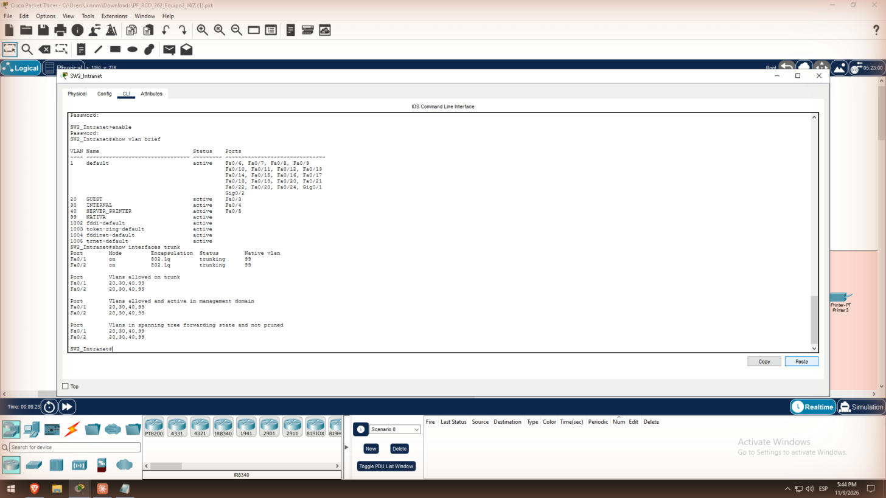
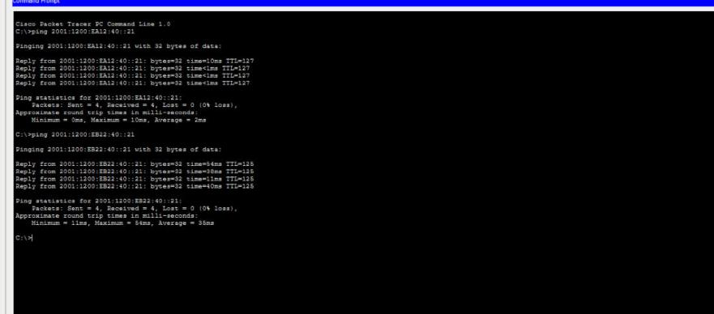

# 4. VLANs, trunks e inter-VLAN (Tarea 5)

Cada sede enruta entre VLANs de una forma distinta: BOG usa router-on-a-stick en R1_BOG y MAD usa SVIs en el MLSW 3650. Todos los enlaces entre switches son trunks 802.1Q con VLAN nativa 99.

| VLAN | Nombre | BOG | MAD |
| --- | --- | --- | --- |
| 20 | GUEST | PC1, PC3 | PC5, PC8 |
| 30 | INTERNAL | PC2, PC4 | PC6, PC7 |
| 40 | SERVER_PRINTER | Printer0, Printer1 | Printer2, Printer3 |
| 99 | NATIVE | Troncales | Troncales |

## Paso 1 – Crear las VLANs

Se crean en todos los switches de BOG y MAD y en el MLSW:

```
vlan 20
 name GUEST
vlan 30
 name INTERNAL
vlan 40
 name SERVER_PRINTER
vlan 99
 name NATIVE
```

## Paso 2 – Trunks

Los troncales son Fa0/1–2 en los 2960 y G1/0/2–3 en el MLSW:

```
interface FastEthernet0/1
 switchport mode trunk
 switchport trunk native vlan 99
 switchport trunk allowed vlan 20,30,40,99
```

## Paso 3 – Puertos de acceso

Los puertos de acceso empiezan en Fa0/3; cada uno va en la VLAN de su equipo:

```
interface FastEthernet0/3
 switchport mode access
 switchport access vlan 20
 spanning-tree portfast
```

## Paso 4 – Router-on-a-stick en R1_BOG

```
interface FastEthernet0/0
 no shutdown
interface FastEthernet0/0.20
 encapsulation dot1Q 20
 ipv6 address FE80::1 link-local
 ipv6 address 2001:1200:EA12:20::1/64
interface FastEthernet0/0.30
 encapsulation dot1Q 30
 ip address 10.12.30.1 255.255.255.0
 ipv6 address FE80::1 link-local
 ipv6 address 2001:1200:EA12:30::1/64
interface FastEthernet0/0.40
 encapsulation dot1Q 40
 ipv6 address FE80::1 link-local
 ipv6 address 2001:1200:EA12:40::1/64
interface FastEthernet0/0.99
 encapsulation dot1Q 99 native
interface FastEthernet0/1
 description DMZ
 ip address 10.12.100.1 255.255.255.0
 ipv6 address FE80::1 link-local
 ipv6 address 2001:1200:EC12:1::1/64
 no shutdown
interface Loopback0
 ipv6 address 2001:1200:ED12::1/128
```

## Paso 5 – SVIs en el MLSW 3650 (MAD)

```
ip routing
ipv6 unicast-routing
interface range GigabitEthernet1/0/2 - 3
 switchport mode trunk
 switchport trunk native vlan 99
interface GigabitEthernet1/0/1
 no switchport
 ip address 10.22.255.2 255.255.255.252
 ipv6 address 2001:1200:ED22:1::2/64
 no shutdown
interface vlan 20
 ipv6 address FE80::1 link-local
 ipv6 address 2001:1200:EB22:20::1/64
interface vlan 30
 ip address 10.22.30.1 255.255.255.0
 ipv6 address FE80::1 link-local
 ipv6 address 2001:1200:EB22:30::1/64
interface vlan 40
 ipv6 address FE80::1 link-local
 ipv6 address 2001:1200:EB22:40::1/64
```

En R2_ESP, Fa0/0 tiene `2001:1200:ED22:1::1/64` y `10.22.255.1/30`, y Loopback0 tiene `2001:1200:ED12::2/128`.

## Router-on-a-stick frente a SVIs

| Criterio | Router-on-a-stick (BOG) | SVIs en MLSW (MAD) |
| --- | --- | --- |
| Dónde se enruta | En el router, por un único enlace troncal | En el switch de capa 3 |
| Rendimiento | Todo el tráfico entre VLANs comparte un enlace | Conmutación en hardware, sin cuello de botella |
| Costo | Reusa el router de borde | Requiere un switch multicapa |
| Uso típico | Sedes pequeñas | Sedes con mucho tráfico entre VLANs |

## Verificación

`show vlan brief` y `show interfaces trunk` en SW2 muestran las VLANs 20/30/40/99 y los troncales con nativa 99:



Las impresoras de las dos sedes responden al ping:


