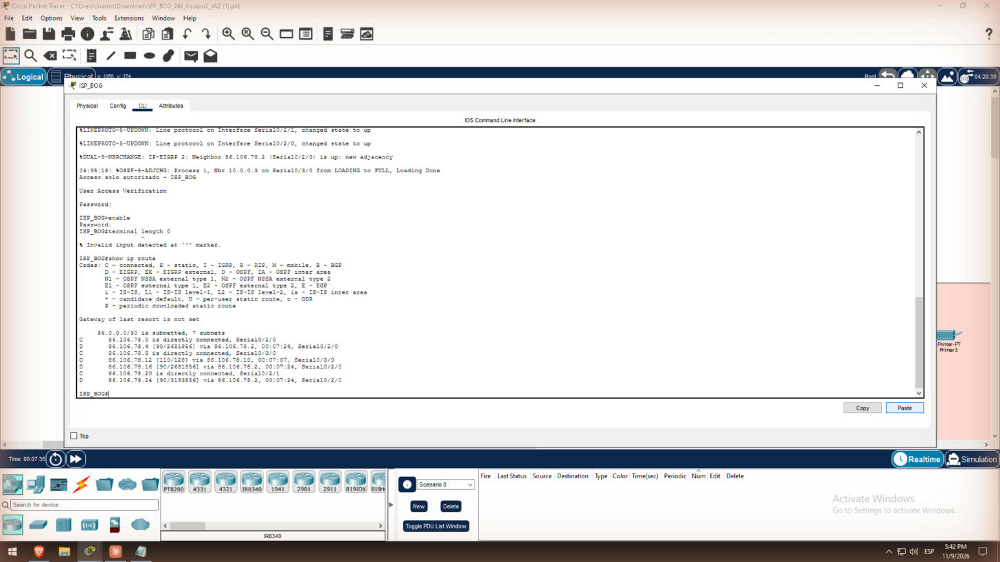
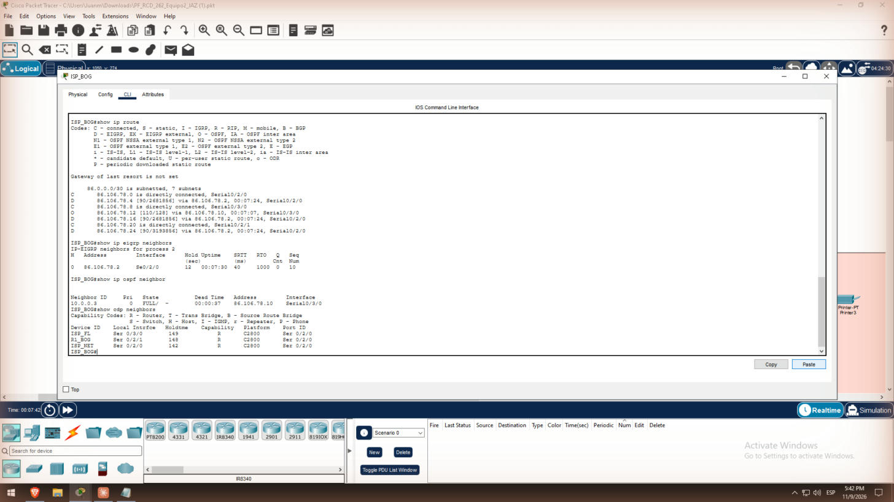
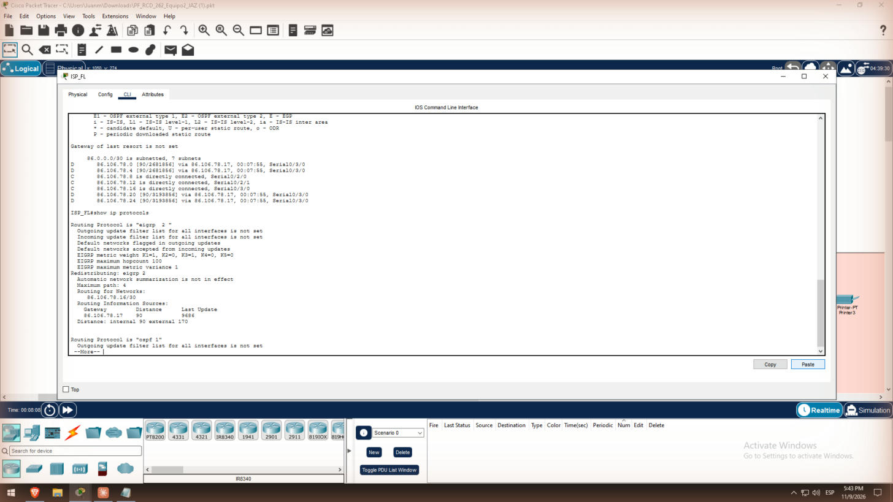
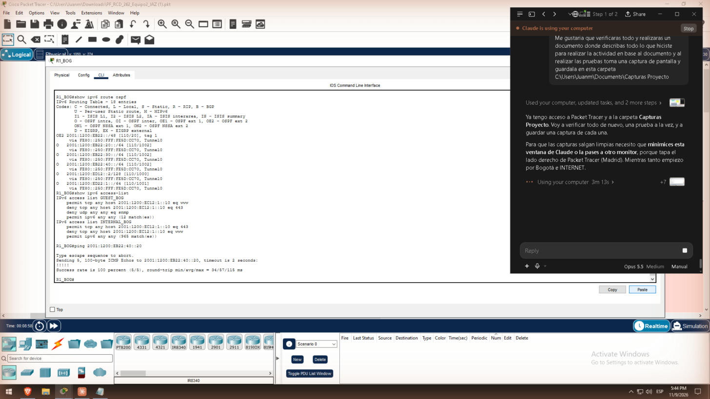

# 5. Enrutamiento (Tarea 5)

La INTERNET tiene dos dominios de enrutamiento: EIGRP AS 2 por el lado de ISP_NET [6] y OSPFv2 área 0 por el lado de ISP_FL [4]. ISP_BOG e ISP_ESP redistribuyen entre ambos. Los routers de borde de la empresa (R1_BOG y R2_ESP) solo tienen una ruta por defecto IPv4. Las intranets se enrutan con OSPFv3 [5] a través del túnel.

| Router | EIGRP AS 2 | OSPFv2 proceso 1, área 0 | Redistribuye |
| --- | --- | --- | --- |
| ISP_BOG | .0/30 | .8/30 | Sí, en ambos sentidos |
| ISP_NET | .0/30, .4/30, .16/30 | .16/30 | No |
| ISP_FL | – | .8/30, .12/30, .16/30 | No |
| ISP_ESP | .4/30 | .12/30 | Sí, en ambos sentidos |

El enlace ISP_NET–ISP_FL corre los dos protocolos, así que hay más de un camino entre los dominios.

## ISP_BOG

ISP_ESP tiene la misma configuración con sus propias redes:

```
router eigrp 2
 network 86.106.78.0 0.0.0.3
 network 86.106.78.20 0.0.0.3
 passive-interface Serial0/2/1
 no auto-summary
 redistribute ospf 1 metric 1544 2000 255 1 1500
router ospf 1
 router-id 10.0.0.1
 network 86.106.78.8 0.0.0.3 area 0
 redistribute eigrp 2 subnets
```

## ISP_NET

```
router eigrp 2
 network 86.106.78.0 0.0.0.3
 network 86.106.78.4 0.0.0.3
 network 86.106.78.16 0.0.0.3
 no auto-summary
router ospf 1
 network 86.106.78.16 0.0.0.3 area 0
```

## ISP_FL

```
router ospf 1
 network 86.106.78.8 0.0.0.3 area 0
 network 86.106.78.12 0.0.0.3 area 0
 network 86.106.78.16 0.0.0.3 area 0
```

## Bordes de la empresa (IPv4)

```
! R1_BOG
ip route 0.0.0.0 0.0.0.0 86.106.78.21
ip route 10.22.0.0 255.255.0.0 10.255.255.2
! R2_ESP
ip route 0.0.0.0 0.0.0.0 86.106.78.25
ip route 10.12.0.0 255.255.0.0 10.255.255.1
! MLSW
ip route 0.0.0.0 0.0.0.0 10.22.255.1
```

Las intranets no se anuncian a la INTERNET: viajan dentro del túnel. La INTERNET solo necesita conocer las IPs públicas .22 y .26.

## OSPFv3 en las intranets

En R1_BOG y R2_ESP, sobre Tunnel0:

```
ipv6 router ospf 1
 router-id 1.1.1.1
 passive-interface FastEthernet0/0.20
 passive-interface FastEthernet0/0.30
 passive-interface FastEthernet0/0.40
 passive-interface FastEthernet0/1
! en cada interfaz IPv6 y en Tunnel0:
 ipv6 ospf 1 area 0
```

En PT, el MLSW no anunció sus SVIs por OSPFv3. Se resolvió con una ruta estática en R2_ESP, redistribuida en OSPFv3, y una ruta por defecto en el MLSW:

```
! R2_ESP
ipv6 route 2001:1200:EB22::/48 2001:1200:ED22:1::2
ipv6 router ospf 1
 router-id 2.2.2.2
 redistribute static
! MLSW
ipv6 route ::/0 2001:1200:ED22:1::1
```

## Verificación

`show ip route` en ISP_BOG muestra rutas conectadas, EIGRP (D), OSPF (O) y redistribuidas:



Los vecinos EIGRP, OSPF y CDP de ISP_BOG están establecidos:



ISP_FL aprende las redes EIGRP como O E2, lo que prueba la redistribución:



En R1_BOG, las redes 2001:1200:EB22::/48 de Madrid se aprenden por Tunnel0, y el ping a Madrid responde:



## Análisis

La redistribución mutua en dos puntos (ISP_BOG e ISP_ESP) puede generar rutas subóptimas o bucles. Las distancias administrativas lo mitigan: EIGRP interno 90, OSPF 110 y EIGRP externo 170. Así una ruta nativa siempre gana a una redistribuida.
