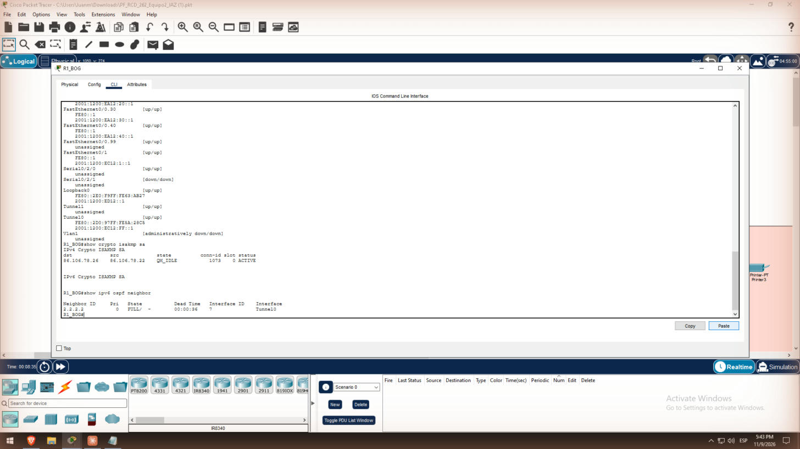
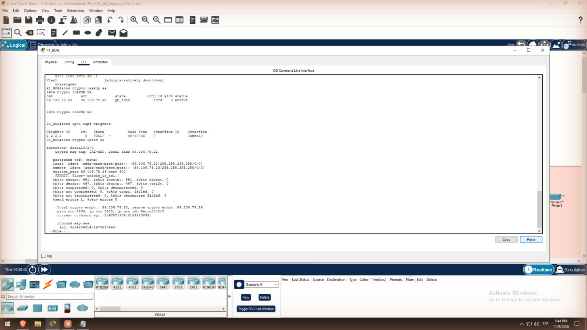

# 6. Migración IPv6 y VPN IPsec (Tarea 6)

**Pregunta guía.** El servicio de migración es un túnel manual IPv6-sobre-IPv4 (6in4, `tunnel mode ipv6ip`) entre R1_BOG y R2_ESP [2]. La seguridad la da una VPN IPsec sitio a sitio sobre las mismas IPs públicas [3]. Solo se configuran los dos routers de borde; los ISP no se tocan.

**Cómo funciona.**

1. R1_BOG mete cada paquete IPv6 dentro de un paquete IPv4 (protocolo 41) que va de 86.106.78.22 a 86.106.78.26.
2. Antes de que salga por S0/2/0, el crypto map lo cifra con ESP.
3. En la INTERNET solo se ve ESP entre las dos IPs públicas.

## R1_BOG – túneles

```
interface Tunnel0
 description Tunel 6in4 hacia R2_ESP
 ipv6 address 2001:1200:EC12:FF::1/64
 ipv6 ospf 1 area 0
 tunnel source Serial0/2/0
 tunnel destination 86.106.78.26
 tunnel mode ipv6ip
interface Tunnel1
 description GRE IPv4 para gestion SNMP
 ip address 10.255.255.1 255.255.255.252
 tunnel source Serial0/2/0
 tunnel destination 86.106.78.26
```

Tunnel1 es un GRE IPv4 que lleva entre sedes la gestión SNMP y el resto del IPv4 privado. También pasa cifrado por IPsec.

## R1_BOG – IPsec

```
crypto isakmp policy 10
 encr aes 256
 authentication pre-share
 group 5
 lifetime 86400
crypto isakmp key JAZvpn2026 address 86.106.78.26
crypto ipsec transform-set JAZ-TS esp-aes esp-sha-hmac
access-list 110 permit ip host 86.106.78.22 host 86.106.78.26
crypto map JAZ-MAP 10 ipsec-isakmp
 set peer 86.106.78.26
 set transform-set JAZ-TS
 match address 110
interface Serial0/2/0
 crypto map JAZ-MAP
```

R2_ESP es el espejo de R1_BOG:

- Tunnel0 con `2001:1200:EC12:FF::2/64` y destino 86.106.78.22.
- Tunnel1 con `10.255.255.2/30`.
- Clave y `set peer` hacia .22.
- `access-list 110 permit ip host 86.106.78.26 host 86.106.78.22`.

La clave, la política ISAKMP y el transform-set son idénticos en los dos routers.

## Ajustes durante la implementación

| Primer intento | Problema | Solución |
| --- | --- | --- |
| `tunnel mode gre ip` para IPv6 | En PT, el GRE no transportaba el IPv6 de las intranets | `tunnel mode ipv6ip` en Tunnel0 |
| ACL crypto con `permit gre` o `permit 41` | PT no aceptó `41`, y con `gre` el resto del tráfico no se cifraba ni pasaba | `permit ip host .22 host .26`, que cifra todo entre los extremos |
| Solo IPv6 entre sedes | La gestión SNMP va por IPv4 privado | Tunnel1 GRE IPv4 más rutas a 10.12/16 y 10.22/16 |

## Verificación

1. `show ipv6 interface brief`: Tunnel0 up/up.
2. `show crypto isakmp sa`: estado QM_IDLE.
3. El vecino OSPFv3 por Tunnel0 está en estado FULL.



4. `show crypto ipsec sa`: los contadores `#pkts encaps` y `#pkts decaps` suben.



5. Hay ping de R1_BOG a la intranet de Madrid, y las rutas EB22 se aprenden por Tunnel0 (captura 07 en [Enrutamiento](05-Enrutamiento)).
6. En modo Simulación, el tráfico del Tracker cruza los ISP encapsulado y cifrado (ver [Employee Tracker](10-Employee-Tracker)).

El primer ping puede fallar mientras se negocia IKE; al repetirlo, responde.
