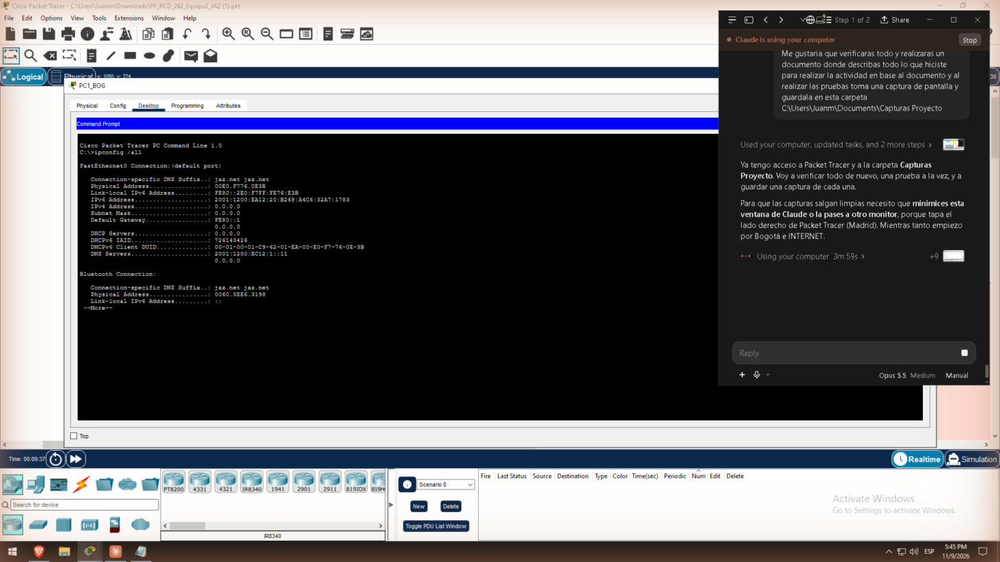
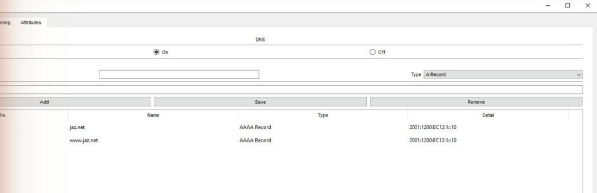

# 7. Servicios: DHCPv6, DNS y Web (Tareas 3 y 4)

**Pregunta guía:** el direccionamiento es estático para infraestructura, servidores, impresoras y PC7, y dinámico para los demás PCs. En ambas sedes se usa **DHCPv6 con estado** [7], servido por el propio gateway: R1_BOG en BOG y el MLSW en MAD. Así cada PC recibe dirección, DNS y dominio en un solo paso.

## 7.1 BOG – DHCPv6 con estado en R1_BOG

```
ipv6 dhcp pool GUEST_BOG
 address prefix 2001:1200:EA12:20::/64
 dns-server 2001:1200:EC12:1::11
 domain-name jaz.net
ipv6 dhcp pool INTERNAL_BOG
 address prefix 2001:1200:EA12:30::/64
 dns-server 2001:1200:EC12:1::11
 domain-name jaz.net
interface FastEthernet0/0.20
 ipv6 nd managed-config-flag
 ipv6 dhcp server GUEST_BOG
interface FastEthernet0/0.30
 ipv6 nd managed-config-flag
 ipv6 dhcp server INTERNAL_BOG
```

`ipv6 nd managed-config-flag` activa el bit M en los Router Advertisement. Ese bit les indica a los PCs que pidan su dirección por DHCPv6 en vez de usar SLAAC.

## 7.2 MAD – DHCPv6 con estado en el MLSW

Usa el mismo esquema con dos pools en las SVIs Vlan20 y Vlan30:

- `GUEST_MAD`: `2001:1200:EB22:20::/64`
- `INTERNAL_MAD`: `2001:1200:EB22:30::/64`

PC7 es estático (`2001:1200:EB22:30::50`) porque el Tracker Server siempre debe conectarse a la misma dirección. Su DNS se configuró a mano.

En cada PC dinámico se usa Desktop → IP Configuration → IPv6 → Automatic.



## 7.3 DNS Server

1. IPv6 estática `2001:1200:EC12:1::11/64` con gateway `2001:1200:EC12:1::1`, más la IPv4 `10.12.100.11`.
2. Services → DNS → On, con dos registros AAAA que apuntan a `2001:1200:EC12:1::10`: `jaz.net` y `www.jaz.net`.



**Por qué el DNS tiene IPv4:** cuando un PC tiene dirección IPv4, el navegador de PT resuelve por el DNS IPv4. Los PCs internos son dual-stack por la gestión SNMP y mostraban «Host Name Unresolved». La solución fue darle al DNS la IPv4 10.12.100.11 y configurarla como DNS IPv4 en PC2, PC4, PC6 y PC7.

## 7.4 Web_Server personalizado

1. IPv6 estática `2001:1200:EC12:1::10/64`, gateway `2001:1200:EC12:1::1` y DNS `::11`.
2. Services → HTTP, con HTTP On y HTTPS On. Los dos deben estar encendidos, porque son las ACLs las que deciden quién usa cada puerto.
3. Se editó `index.html` con la página del equipo 2 / JAZ.net.

Las pruebas de acceso web desde cada tipo de usuario están en [ACLs](08-ACLs).
