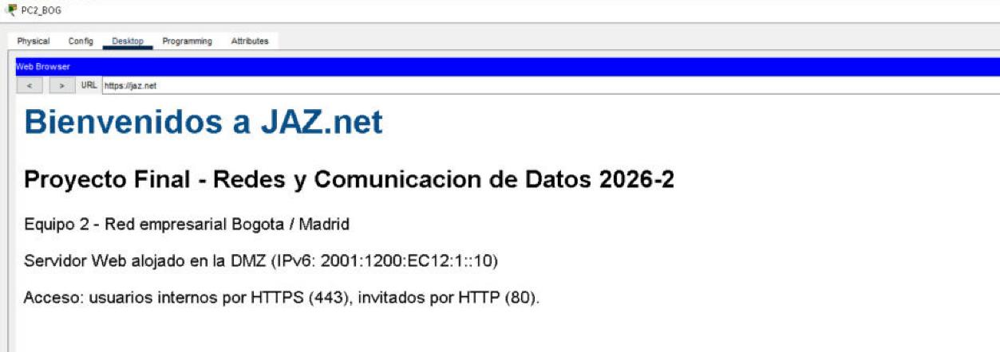
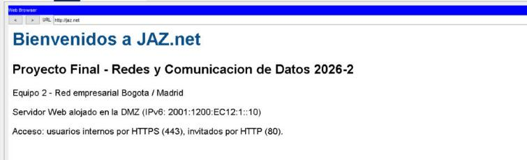
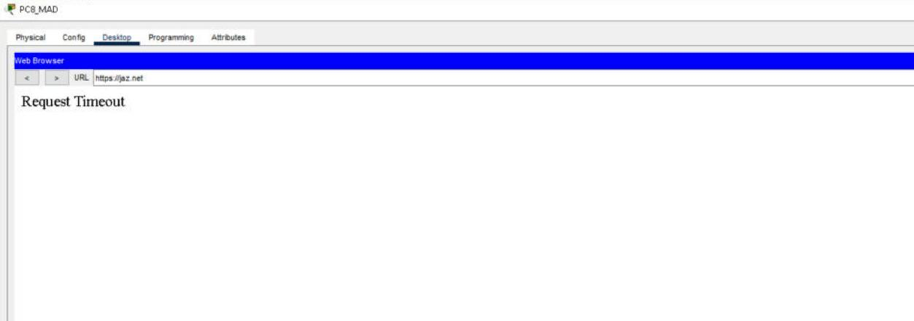
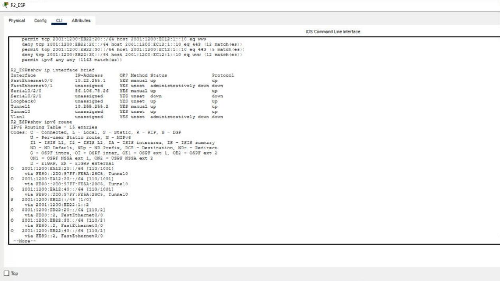

# 8. Listas de control de acceso (Tareas 4 y 7)

**Pregunta guía.** El servicio es un filtrado de paquetes con ACLs IPv6 extendidas. Se aplican de entrada, lo más cerca posible del origen.

- **BOG:** en las subinterfaces de R1_BOG.
- **MAD:** en R2_ESP Fa0/0. Por ahí sale hacia la DMZ todo el tráfico de Madrid, y así no se depende de `ipv6 traffic-filter` en las SVIs del 3650.

## Matriz de política (resultado obtenido)

| Origen | HTTP :80 al Web | HTTPS :443 al Web | SNMP :161 |
| --- | --- | --- | --- |
| BOG Guest (PC1, PC3) | Permitido | Bloqueado | Bloqueado |
| BOG Internal (PC2, PC4) | Bloqueado | Permitido | Permitido |
| MAD Guest (PC5, PC8) | Permitido | Bloqueado | Bloqueado |
| MAD Internal (PC6, PC7) | Bloqueado | Permitido | Permitido |

## R1_BOG

```
ipv6 access-list GUEST_BOG
 permit tcp any host 2001:1200:EC12:1::10 eq www
 deny tcp any host 2001:1200:EC12:1::10 eq 443
 deny udp any any eq snmp
 permit ipv6 any any
ipv6 access-list INTERNAL_BOG
 permit tcp any host 2001:1200:EC12:1::10 eq 443
 deny tcp any host 2001:1200:EC12:1::10 eq www
 permit ipv6 any any
interface FastEthernet0/0.20
 ipv6 traffic-filter GUEST_BOG in
interface FastEthernet0/0.30
 ipv6 traffic-filter INTERNAL_BOG in
```

## R2_ESP

Una sola ACL, con el prefijo de cada VLAN como origen:

```
ipv6 access-list FILTRO_MAD
 permit tcp 2001:1200:EB22:20::/64 host 2001:1200:EC12:1::10 eq www
 deny tcp 2001:1200:EB22:20::/64 host 2001:1200:EC12:1::10 eq 443
 permit tcp 2001:1200:EB22:30::/64 host 2001:1200:EC12:1::10 eq 443
 deny tcp 2001:1200:EB22:30::/64 host 2001:1200:EC12:1::10 eq www
 permit ipv6 any any
interface FastEthernet0/0
 ipv6 traffic-filter FILTRO_MAD in
```

**Por qué terminan en `permit ipv6 any any`:** sin esa línea, el deny implícito bloquearía DNS, ICMPv6 (que incluye Neighbor Discovery), OSPFv3, el Tracker y el resto de servicios.

## Verificación

Cada celda de la matriz se probó desde el navegador del PC correspondiente: la página carga o aparece «Request Timeout».

| Prueba | Resultado | Captura |
| --- | --- | --- |
| PC1 (Guest BOG) → http://jaz.net | Abre | 11 |
| PC1 (Guest BOG) → https://jaz.net | Bloqueado | 12 |
| PC2 (Internal BOG) → https://jaz.net | Abre | 13 |
| PC2 (Internal BOG) → http://jaz.net | Bloqueado | 14 |
| PC7 (Internal MAD) → https://jaz.net | Abre | 15 |
| PC7 (Internal MAD) → http://jaz.net | Bloqueado | 16 |
| PC5 (Guest MAD) → http://jaz.net | Abre | 17 |
| PC8 (Guest MAD) → https://jaz.net | Bloqueado | 18 |
| PC6 (Internal MAD) → https://jaz.net | Abre | 19 |
| PC3 (Guest BOG) → http://jaz.net | Abre | 20 |

| Interno con HTTPS (PC2) | Invitado con HTTPS (PC1) |
| --- | --- |
|  |  |

| Invitado con HTTP (PC5) | Invitado con HTTPS (PC8) |
| --- | --- |
|  |  |

`show ipv6 access-list` muestra las coincidencias de cada línea, en R1_BOG (captura 07) y en R2_ESP:


