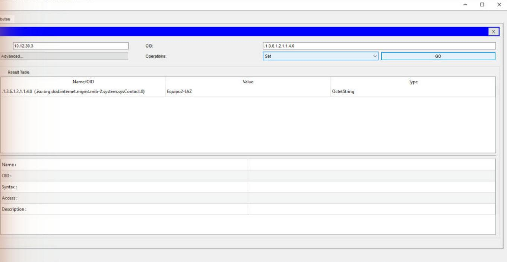
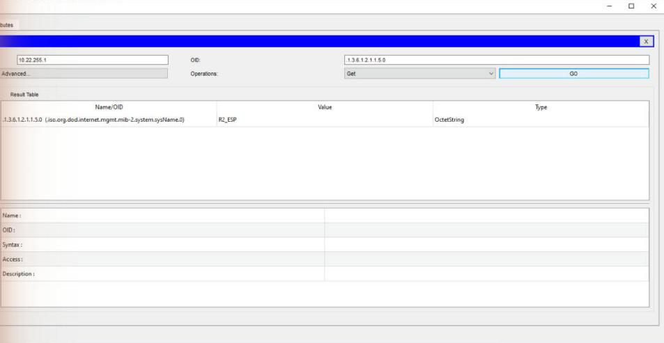
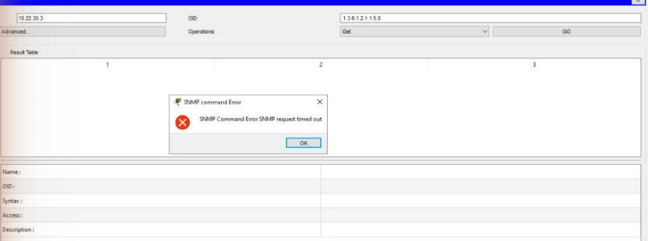
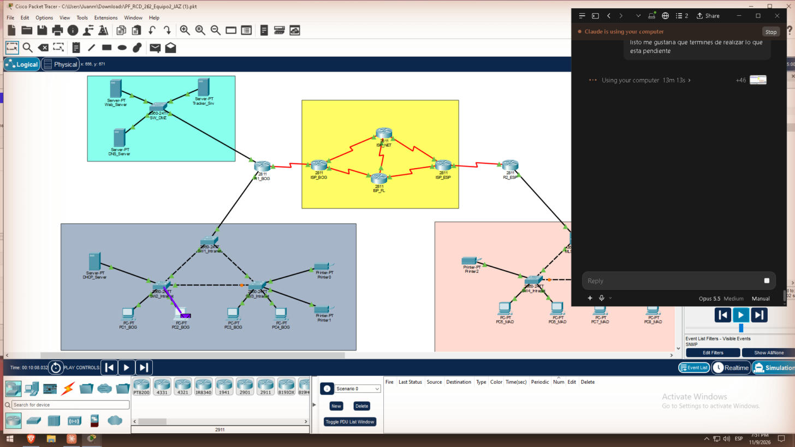
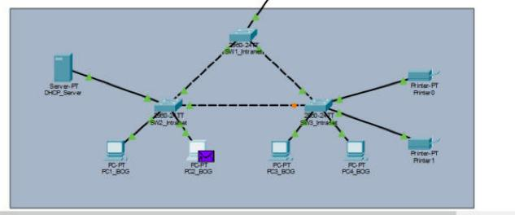

# 9. Gestión con SNMP (Tarea 7 y Resultado 4)

Solo los PCs de la VLAN Internal pueden gestionar los equipos por SNMP. Cada agente tiene una comunidad de lectura y otra de escritura. La gestión viaja por IPv4 privado, que solo existe en la VLAN 30 Internal, en la DMZ y en los equipos de red.

## Agentes

Se configuraron en R1_BOG, R2_ESP, los switches 2960 de BOG y MAD y el MLSW:

```
snmp-server community jazRO RO
snmp-server community jazRW RW
```

## Cómo se garantiza el acceso solo desde la VLAN interna

1. **Direccionamiento:** los invitados no tienen IPv4, y los agentes solo atienden SNMP en su IPv4 de gestión. Un PC invitado no tiene ruta hacia ellos.
2. **ACL:** en BOG, `GUEST_BOG` también descarta todo el tráfico UDP 161 que sale de la VLAN 20 (ver [ACLs](08-ACLs)).
3. **Prueba negativa:** el GET desde PC8 (invitado de MAD) termina en timeout.

PT rechazó `snmp-server community jazRO RO 10`, es decir, ligar la comunidad a una ACL estándar. Por eso las comunidades quedaron sin ACL y la restricción depende de los dos puntos anteriores.

## Manager (MIB Browser)

En PC2 (BOG) o PC7 (MAD): Desktop → MIB Browser → Advanced.

- **Address:** la IPv4 de gestión del equipo. Por ejemplo, R1_BOG es 10.12.30.1 y SW2 está en 10.12.30.x.
- **Comunidades:** lectura `jazRO`, escritura `jazRW`.
- **Versión:** **v2**. Con v1 las peticiones agotaban el tiempo.
- **Primera petición:** puede agotar el tiempo mientras se resuelve ARP; la segunda responde.

| Prueba | Desde → hacia | Resultado | Captura |
| --- | --- | --- | --- |
| GET sysName | PC2 → SW2 | Devuelve el nombre | 23 |
| SET sysName | PC2 → SW2 | Valor escrito y leído de vuelta | 24 |
| GET | PC2 → R1_BOG | OK | 25 |
| GET | PC7 → SW5 | OK | 26 |
| GET | PC7 → R2_ESP | OK | 27 |
| GET | PC8 (invitado) → agente de MAD | Timeout (esperado) | 28 |
| GET | PC7 → MLSW_MAD | Timeout (limitación del 3650 en PT) | 29 |

| GET desde PC2 a SW2 | SET desde PC2 a SW2 |
| --- | --- |
|  |  |

| GET desde PC7 a R2_ESP | Invitado PC8 rechazado |
| --- | --- |
|  |  |

## Análisis del flujo SNMP get/set (Resultado 4)

En modo Simulación se dejó solo SNMP en Edit Filters, se ejecutó el GET desde PC2 y se abrió cada PDU [8]:

1. **GetRequest:** va de PC2 al agente, por UDP desde un puerto aleatorio al 161. Lleva la comunidad de lectura y el OID pedido.
2. **GetResponse:** va del agente a PC2, del UDP 161 al puerto del manager, con el valor de la variable.
3. **SetRequest:** es igual que el GET, pero lleva la comunidad de escritura y el nuevo valor.
4. **GetResponse al Set:** confirma el valor escrito, o devuelve un error si la comunidad no es la correcta.

| GetRequest (PC2 → agente) | GetResponse (agente → PC2) |
| --- | --- |
|  |  |

**Conclusión:** SNMPv2c viaja en texto claro, así que la comunidad se puede leer en la PDU. Por eso solo se permite desde la VLAN Internal, y entre sedes solo cruza la INTERNET dentro del túnel cifrado con IPsec. En una red real convendría SNMPv3, que agrega autenticación y cifrado.
