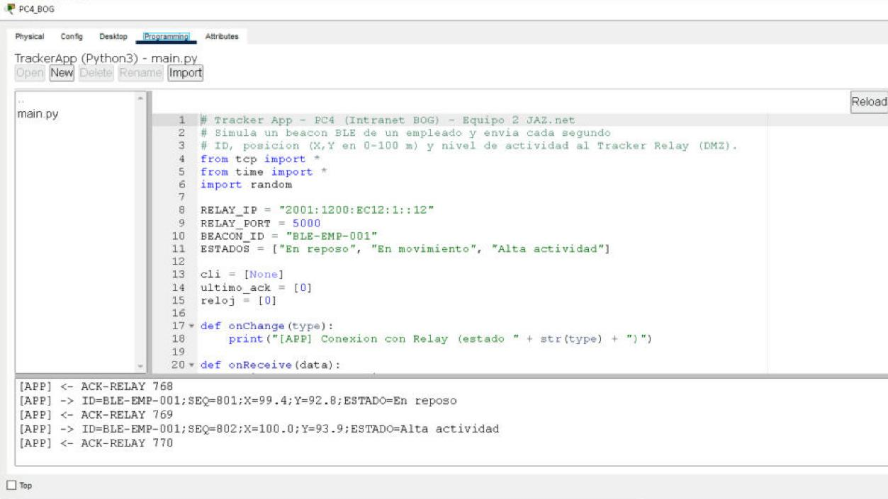
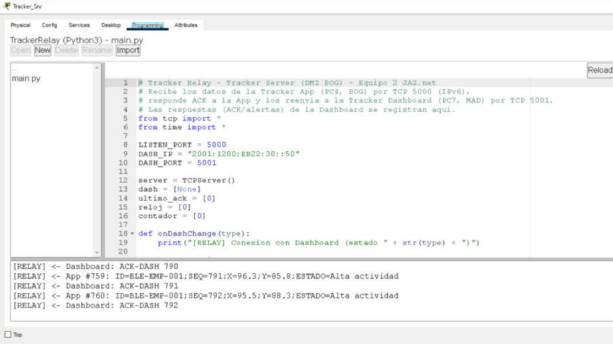
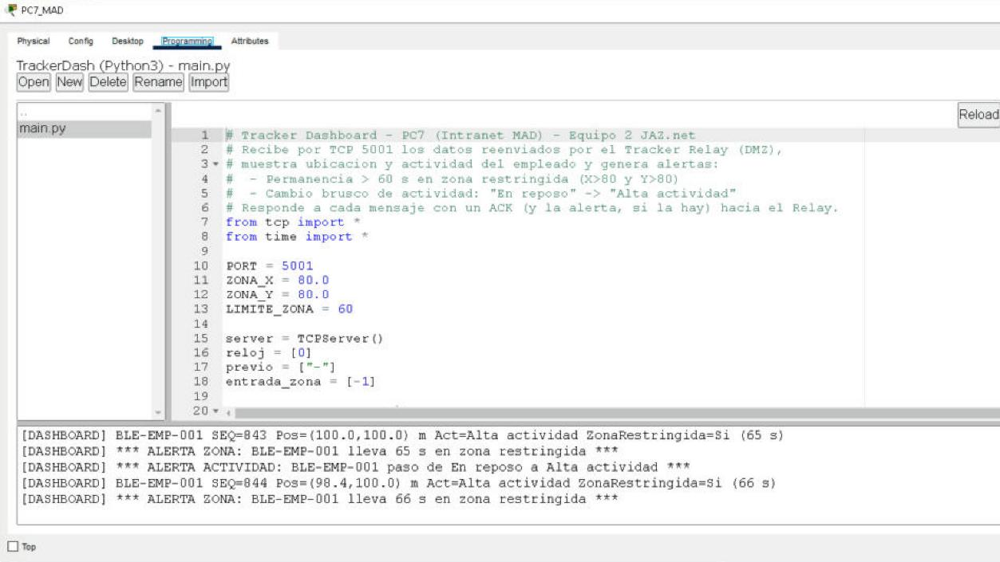
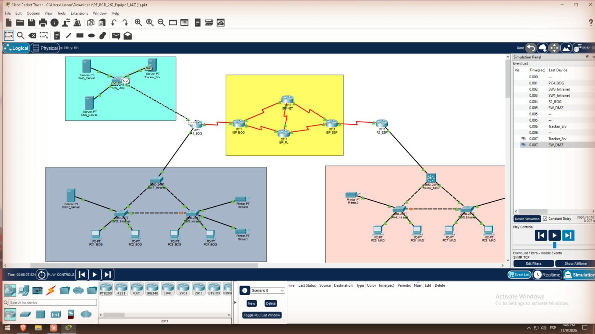
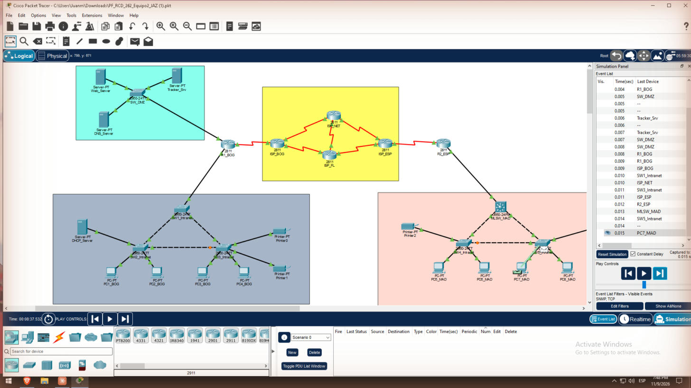

# 10. Employee Tracker con sockets TCP (Tarea 9 y Resultado 3)

El Employee Tracker son tres programas Python de Packet Tracer (Desktop → Programming → New → Empty – Python → `main.py`), todos sobre IPv6.

El flujo es **PC4 (Tracker App) → TCP 5000 → Tracker Server (Relay) → TCP 5001 → PC7 (Dashboard)**. Cada salto responde con un ACK de aplicación, así que el flujo es bidireccional.

| Programa | Equipo | Dirección / puerto | Función |
| --- | --- | --- | --- |
| TrackerApp | PC4 (BOG, Internal) | Cliente → `2001:1200:EC12:1::12`, puerto 5000 | Simula el beacon BLE y envía las lecturas |
| TrackerRelay | Tracker Server (DMZ) | Escucha en 5000; cliente → `2001:1200:EB22:30::50`, puerto 5001 | Confirma a la App y reenvía al Dashboard |
| TrackerDash | PC7 (MAD, Internal) | Escucha en 5001 | Muestra las lecturas y genera alertas |

## Formato de los mensajes

| Mensaje | Sentido | Ejemplo |
| --- | --- | --- |
| Lectura | App → Relay → Dashboard | `ID=BLE-EMP-001;SEQ=42;X=83.5;Y=81.2;ESTADO=Alta actividad` |
| ACK del Relay | Relay → App | `ACK-RELAY 42` |
| ACK del Dashboard | Dashboard → Relay | `ACK-DASH 42\|<alertas activas>` |

## 10.1 Tracker App – PC4

- Constantes: `BEACON_ID = "BLE-EMP-001"`, `RELAY_IP = "2001:1200:EC12:1::12"` y puerto 5000.
- Genera X e Y con una deriva aleatoria que lleva al empleado hacia la zona restringida (X > 80 y Y > 80). Cada 150 lecturas reinicia el escenario.
- El estado cambia según la actividad simulada: «En reposo», «En movimiento» o «Alta actividad».
- **Reconexión:** si no llega `ACK-RELAY` en 15 s, crea un nuevo `TCPClient` y se reconecta.

```python
from tcp import *
from time import *
client = TCPClient()
def onReceive(data):
    global ultimo_ack
    ultimo_ack = uptime()          # llega "ACK-RELAY n"
    print("[APP] " + data)
# bucle principal: arma "ID=..;SEQ=..;X=..;Y=..;ESTADO=..",
# client.send(msg), y si uptime() - ultimo_ack > 15 -> reconectar
```

## 10.2 Tracker Relay – Tracker Server (DMZ)

- Un `TCPServer` escucha en el puerto 5000; en `onNewClient` registra el `onReceive` de la App.
- Por cada lectura responde `ACK-RELAY n` a la App y la reenvía al Dashboard (`DASH_IP = "2001:1200:EB22:30::50"`, puerto 5001).
- **Reconexión:** si el Dashboard no confirma en 15 s, crea de nuevo el `TCPClient` hacia PC7.

## 10.3 Tracker Dashboard – PC7

- Un `TCPServer` escucha en el puerto 5001 e imprime cada lectura.
- **ALERTA ZONA:** el empleado pasa más de 60 s seguidos con X > 80 y Y > 80. Mensaje: `ALERTA ZONA: BLE-EMP-001 lleva N s en zona restringida`.
- **ALERTA ACTIVIDAD:** el estado pasa de «En reposo» a «Alta actividad». Mensaje: `ALERTA ACTIVIDAD: BLE-EMP-001 paso de En reposo a Alta actividad`.
- Guarda las alertas en una lista, las imprime y las devuelve en `ACK-DASH seq|alertas`.

**Orden de arranque recomendado:**

1. Dashboard en PC7.
2. Relay en Tracker Server.
3. App en PC4.

Si se arranca en otro orden, la reconexión automática lo recupera en unos 15 s. El código completo de cada programa está en el `main.py` de su equipo, dentro del `.pkt`.

## Consolas

| Tracker App (PC4) | Tracker Relay (Tracker Server) |
| --- | --- |
|  |  |

Dashboard en PC7, con las dos alertas:



## Análisis del flujo (Resultado 3)

En modo Simulación se dejó solo TCP en Edit Filters:

1. **App → Relay** (captura 33). El segmento va de PC4 al switch de acceso, SW1, R1_BOG, SW_DMZ y Tracker Server, al puerto 5000. No usa el túnel.
2. **Relay → Dashboard** (captura 34). Va de Tracker Server a R1_BOG, entra en Tunnel0 (IPv6 dentro de IPv4, cifrado con ESP), cruza los ISP y sigue por R2_ESP, el MLSW y SW5 hasta PC7, al puerto 5001.
3. **ACK de vuelta** (captura 35). El `ACK-DASH` regresa por el mismo camino, y el Relay le confirma a la App con `ACK-RELAY`.

| PC4 → Tracker Server | Relay → PC7 por el túnel | ACK de vuelta |
| --- | --- | --- |
|  |  |  |

**Conclusión:** TCP es un flujo de bytes, no un sistema de mensajes. Por eso cada lectura va en un `send` independiente, y el ACK de aplicación confirma que llegó de extremo a extremo, además de los ACK propios de TCP. Que la App y el Relay se reconecten solos hace que el sistema tolere un arranque desordenado o un corte del enlace.

**Bonus (vista web del Dashboard):** no se implementó, porque los PCs de Packet Tracer 9.0.1 no ofrecen servidor HTTP en Programming. Las alertas se ven en la consola de PC7 y viajan en el ACK.
