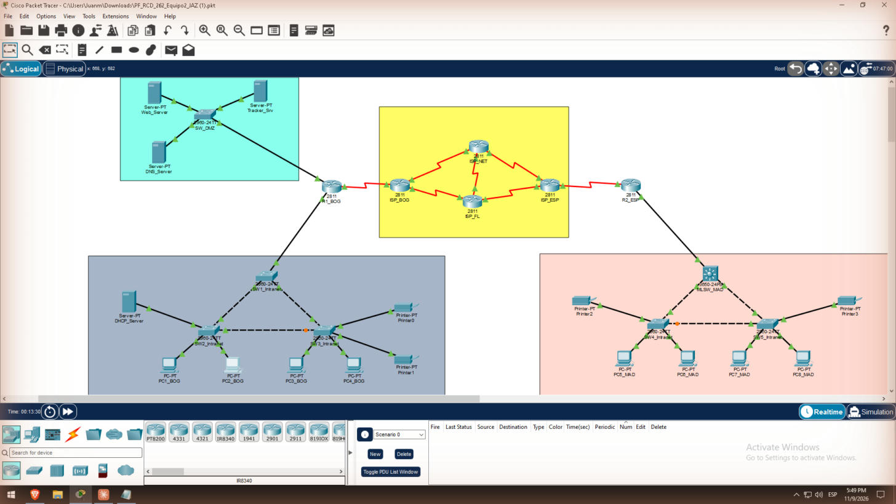

# Red Empresarial JAZ.net — Proyecto Final RCD 2026-2 (Equipo 2)

Proyecto final de **Redes y Comunicación de Datos 2026-2**: diseño, montaje, configuración y verificación en Cisco Packet Tracer 9.0.1 de la red empresarial de **JAZ.net**, con X = 2.

## Integrantes

- Andrés Felipe Ramos
- Sara Velandia
- Juan Manuel Castro

## Resumen

La red tiene tres zonas IPv6 (Intranet Bogotá, DMZ e Intranet Madrid) unidas por una INTERNET solo IPv4 de cuatro ISP con dos dominios de enrutamiento (EIGRP y OSPFv2). La pieza central es un túnel IPv6-sobre-IPv4 (6in4) protegido con IPsec entre R1_BOG y R2_ESP [2], [3]. Sobre esa base funcionan las VLANs, el DHCPv6, el DNS y el sitio web `jaz.net`, las ACLs por tipo de usuario, la gestión SNMP desde la VLAN interna y la aplicación **Employee Tracker** con sockets TCP.

| Resultado | Estado |
| --- | --- |
| Direccionamiento IPv4/IPv6 (X = 2) | Completo |
| VLANs e inter-VLAN (router-on-a-stick y SVIs) | Completo |
| EIGRP + OSPF con redistribución | Completo |
| Túnel 6in4 + VPN IPsec | Completo |
| DHCPv6, DNS `jaz.net` y Web | Completo |
| ACLs (invitados solo HTTP, internos solo HTTPS) | Completo |
| SNMP solo desde la VLAN interna | Completo (el MLSW 3650 no responde en PT) |
| Employee Tracker con alertas | Completo |
| Verificación | 37 pruebas con captura |

## Contenido de la Wiki

1. [Metodología](01-Metodologia)
2. [Esquema de direccionamiento](02-Direccionamiento)
3. [Montaje y configuración básica](03-Montaje-y-Configuracion-Basica)
4. [VLANs, trunks e inter-VLAN](04-VLANs-e-Inter-VLAN)
5. [Enrutamiento EIGRP, OSPF y OSPFv3](05-Enrutamiento)
6. [Migración IPv6 y VPN IPsec](06-Tunel-IPv6-e-IPsec)
7. [Servicios: DHCPv6, DNS y Web](07-Servicios-DHCPv6-DNS-Web)
8. [Listas de control de acceso](08-ACLs)
9. [Gestión con SNMP y análisis del flujo get/set](09-SNMP)
10. [Employee Tracker y análisis del flujo TCP](10-Employee-Tracker)
11. [Resultados y verificación](11-Resultados-y-Verificacion)
12. [Retos y soluciones por capa TCP/IP](12-Retos-y-Soluciones)
13. [Conclusiones y recomendaciones](13-Conclusiones)
14. [Referencias](14-Referencias)
15. [Roles, actas y contribuciones](15-Roles-Actas-y-Contribuciones)
16. [Uso de IA](16-Uso-de-IA)

## Archivos del repositorio

- `Capturas Proyecto/`: las 37 capturas de verificación, numeradas como en [Resultados y verificación](11-Resultados-y-Verificacion).
- Archivo `.pkt` de la topología y `.txt` de configuración de cada equipo.

Las referencias entre corchetes, como [1], remiten a la página [Referencias](14-Referencias).
